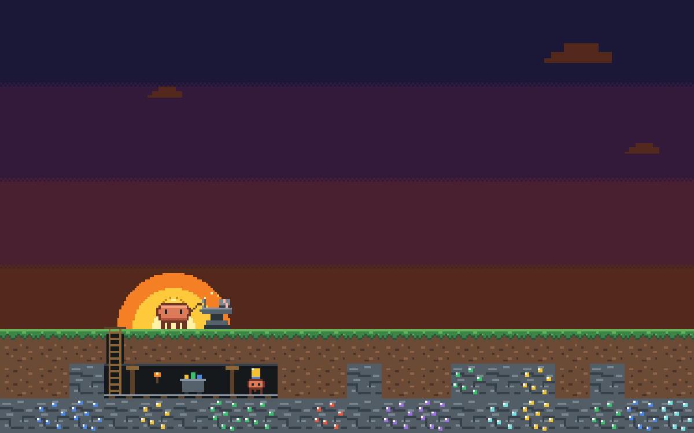
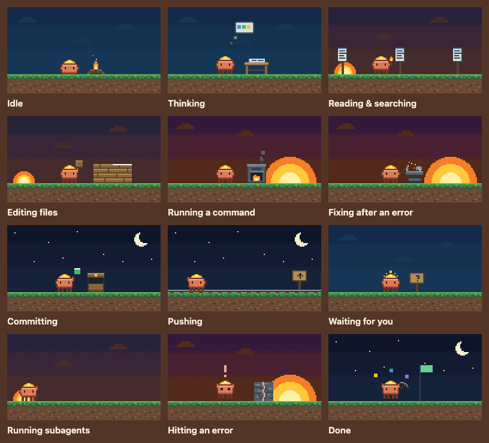
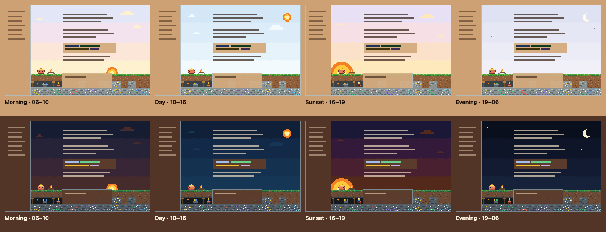

# Block Shift

A block-world theme for the Claude Code desktop app. It paints the app in earthy dirt tones and puts a living scene behind the conversation: a little miner who acts out what the agent is doing, under a sky that follows the time of day.

<p align="center"></p>

## Install

At the prompt of a terminal session:

```
/plugin install block-shift --marketplace SametGoktepe/block-shift
```

From a shell:

```
claude plugin install block-shift --marketplace SametGoktepe/block-shift
```

In the desktop app, click **+** next to the prompt box, then **Plugins**, **Add marketplace** with `SametGoktepe/block-shift`, then **Add plugin**.

The theme shows in local sessions of the desktop and mobile apps. The terminal and editors don't draw themes. A session holds one theme at a time, so turn off any other theme mod first.

## What the miner does

| When the agent is… | The miner… |
|---|---|
| idle | sits by the campfire |
| thinking | stands at the drafting table while a plan appears in a thought bubble |
| reading or searching | walks past file boards with a torch |
| editing files | stacks plank blocks into a wall |
| running a command | waits by a lit furnace |
| fixing after an error | hammers a cracked piece on the anvil |
| committing | drops an emerald cube into a chest |
| pushing | sends a loaded minecart down the rail |
| waiting for you | stands by a question-mark sign |
| running subagents | guides small helpers carrying ore |
| hitting an error | jumps back as a stone block collapses |
| done | raises its pickaxe and celebrates |



The sky changes with your local time: morning (06–10), day (10–16), sunset (16–19) and evening (19–06), each in a light and a dark version that follows your system appearance. Below the grass lies a mine full of ore veins and a gallery under the miner's camp.



## Commands

```
/shift play     the scene moves (default)
/shift pause    the scene stands still, but still follows the agent
/shift off      back to the app's own look
```

Your choice is kept for the next sessions. The scene also stands still when your system asks for reduced motion.

## Notes

- The miner's camp sits between the left sidebar and the conversation column, so a panel opened on the right doesn't cover it. On a very narrow window with the sidebar open, the sidebar can cover it.
- Text sits on a frosted layer over the scene; every text colour was checked for contrast on every sky.
- Permission prompts don't switch the miner to "waiting": the signal also fires in auto mode, where nobody is being asked.

## Credits

All pixel art is original and drawn for this theme. It borrows the spirit of block-building games, not their textures, characters or logos.

`hooks/make-colors.js` is Claude Code's own colour helper, copied unchanged as the plugin guide instructs; it turns a few colours into the app's full palette.

## License

MIT. See [LICENSE](LICENSE).
